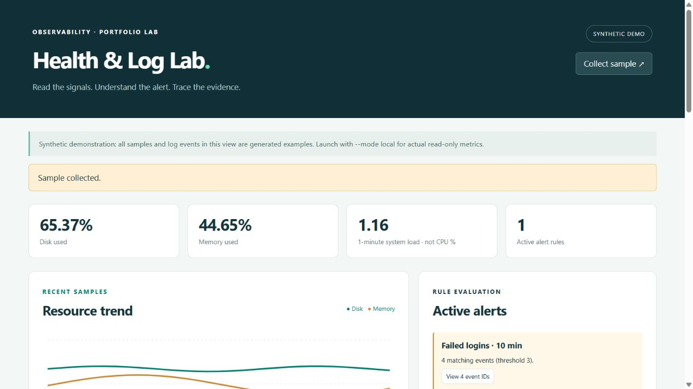
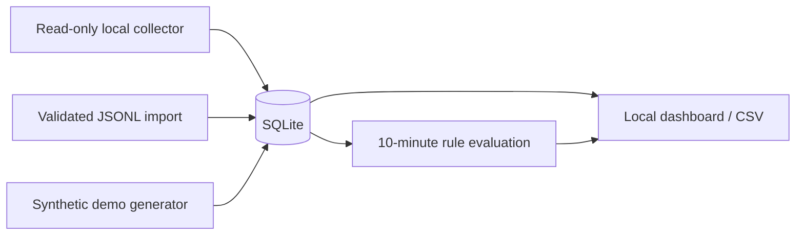

# System Health & Log Monitor

A local observability lab combining read-only resource measurements, structured log exploration and transparent alert rules. Python standard library, SQLite and vanilla JavaScript; no external telemetry or runtime dependencies.



## Run the synthetic demonstration

Python 3.10 or newer. From this repository:

```sh
python monitor.py serve --mode demo
```

Open **http://127.0.0.1:9876**. The banner explicitly identifies synthetic samples and events. The application creates `data/monitor.sqlite3` (ignored by Git) and seeds 30 samples and 18 events once. **Collect sample** appends another synthetic sample. Stop with Ctrl+C.

## Collect actual local metrics

```sh
python monitor.py collect
python monitor.py serve --mode local
```

Local mode measures disk use/free capacity, Windows/Linux memory use where supported and the OS-provided 1-minute load average where supported. **Load average is not CPU utilisation.** Missing metrics display **Unavailable** and remain `null`, rather than fabricated zeroes. Windows typically has no load average. On other platforms memory measurement can be unavailable.

Choose a disk with `--disk-path C:\` on Windows or `--disk-path /` on Linux. Local mode takes one sample at startup and one for each **Collect sample** click. There is no background polling, scheduled task or service installation.

## Import and investigate logs

The application does not read operating system logs automatically. Import a JSONL file from the CLI:

```sh
python monitor.py import-logs --file samples/events.jsonl
python monitor.py report --mode local
```

Each line has exactly these fields:

```json
{"timestamp":"2026-10-28T12:00:00+00:00","severity":"WARNING","source":"lab-auth","event":"login_failed","message":"Synthetic sign-in failure for lab-user"}
```

Accepted severities: `INFO`, `WARNING`, `ERROR`, `CRITICAL`. Timestamps require an explicit timezone. The example file is synthetic and uses fixed dates: historical imports remain visible in the table but do not trigger current 10-minute rules. Use your own non-sensitive lab events for a current scenario. Invalid imports reject the entire batch; reimporting identical normalised events does not duplicate them.

Demo and imported events are kept separate. The demo dashboard shows demo events; local mode shows CLI-imported events. Both can share one database without mixing provenance.

## Alert rules

| Rule | Trigger | Evidence |
|---|---|---|
| Disk usage | Latest measured/synthetic sample ≥85% used | Latest disk sample |
| Error burst | At least 5 ERROR/CRITICAL events in the last 10 minutes | Matching event IDs |
| Failed logins | At least 3 `login_failed` events in the last 10 minutes | Matching event IDs |

Future events are excluded. Rules inspect the whole relevant window; the explorer/export shows at most the latest 500 events, and the trend shows at most 60 samples. If a rule matches more than 500 events, some evidence IDs can be outside the loaded table. Rule thresholds are explicit constants in `rules()`; there is no anomaly-detection or machine-learning claim.

Filter by severity, source, event name or message; click an alert to filter the loaded event evidence. CSV export exports the loaded dataset, not the current search filter. The chart plots only available values and leaves gaps when a metric is unavailable.



## Tests

```sh
python -m unittest discover -s tests -v
```

Tests cover schema/timezone validation, line-number errors, import size, atomicity, deduplication, provenance separation, alert thresholds and time windows, future-event rejection, evaluation beyond the display cap, null metrics, CSV escaping, HTTP collection and local access boundaries. See `docs/verification.md` for the tested runtime and browser checks.

## Scope and boundaries

This is a personal standalone monitoring exercise, not an ELK, Grafana, Splunk or ITSI deployment. No remote agents, port scans, remediation, arbitrary web file access or system changes are performed. There is no authentication; the HTTP server binds only to localhost and validates Host/Origin plus a custom header for writes. Imports are CLI-only, limited to 1 MiB and 5000 events. No external services or CDNs are contacted by the app. Do not expose the built-in server to the Internet. Use non-sensitive lab data; databases are not part of the repository. Full retention management and multi-host monitoring are outside this version's scope.

## Résumé en français

Projet personnel de supervision locale : collecte en lecture seule des ressources disponibles, ingestion de journaux JSONL, contrôles de validité, dédoublonnage, règles d’alerte explicites et tableaux de bord. Mode démonstration fictif séparé des mesures réelles et des journaux importés. Python, SQLite, JavaScript et tests automatisés.

Licensed under the MIT License.
